# PrimeID — Prove the fact, keep the document

PrimeID is a **KeyOS app for Foundation Passport Prime** that turns the device into a vault for signed
credentials. A person proves one fact (for example *"I am over 18"*) without handing over the document
behind it. The verifier gets a cryptographically signed answer bound to its own one-time request; the
user's name, address and document number never leave Prime.

> Everything shown below is real: real secp256k1 signatures, real salted-hash selective disclosure,
> real QR codes, and a key derived from KeyOS's secure-element app seed. The screenshots were captured
> from the app running in the official KeyOS simulator (`foundation sim`) by the automated test
> `scripts/sim-e2e.sh`. The issuer and verifier are mock parties played by a laptop CLI.

---

## Why

- **Oversharing:** to prove one fact, people upload a whole ID.
- **AI forgeries:** a photo or PDF of an ID proves nothing anymore; anyone can generate one.
- **KYC leaks:** central servers full of passport scans eventually leak.
- **Policy:** regulators (e.g. the G7 DPAs, June 2026) want age checks that collect only what is necessary.

PrimeID answers with **a signature, not a document**, and the approval happens on Prime's trusted
screen, not on a phone or browser that may be compromised.

## How it works (3 parties)

```
 Issuer (bank / gov / university)        Passport Prime (PrimeID)               Verifier (shop / exchange)
 ───────────────────────────────         ─────────────────────────              ──────────────────────────
 1. reads Prime's holder key QR  ◄────── shows holder key (from SE app seed)
 2. signs credential bound to    ──QR──► checks issuer sig, trust list,
    that key (salted claim hashes)       holder binding, expiry, each salt
                                         stores it in encrypted app storage
                                                                         ◄──QR── 3. signed request: "prove over_18"
                                         shows requester (verified/unknown),            + one-time nonce
                                         what is shared, what stays
                                         user taps Approve on device
                                         reveals ONE claim + salt, signs  ──QR──► 4. checks issuer sig, claim hash,
                                         with bound key, binds to nonce             holder sig, nonce, expiry
```

**Selective disclosure:** the issuer signs `sha256(salt:key:value)` for every claim. Prime reveals only the
requested `key`, `value` and `salt`; the verifier recomputes the hash and finds it inside the issuer-signed
list. The other claims stay as opaque hashes.

**Wire format:** secp256k1 ECDSA, compact `r‖s`, over SHA-256 of RFC 8785 canonical JSON. The device side
(Rust, `k256`) and the laptop side (JS, `@noble/curves`) are cross-checked by shared test fixtures.

## Demo video

[**Watch the full demo: docs/PrimeID_Demo.mp4**](docs/PrimeID_Demo.mp4). It's a screen recording of the real app in the KeyOS simulator: the honest flow, all four attacks, and revocation.

## Screenshots (real app in the KeyOS simulator)

| Holder key QR | Credential stored | Request review | Signed answer |
|---|---|---|---|
| 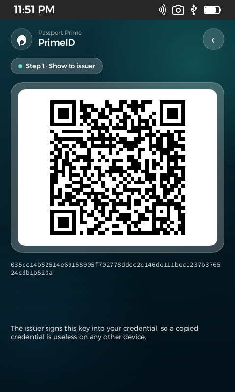 | 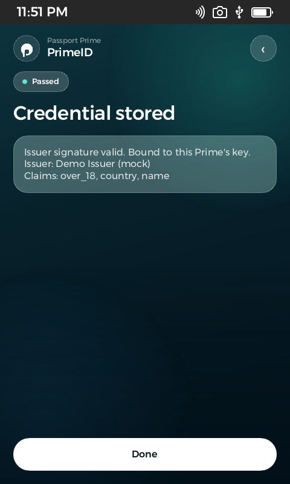 | 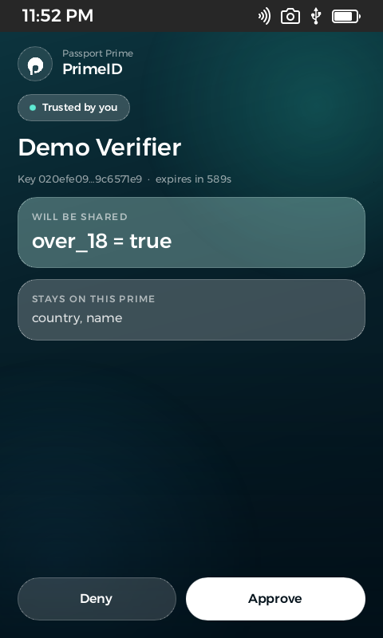 | 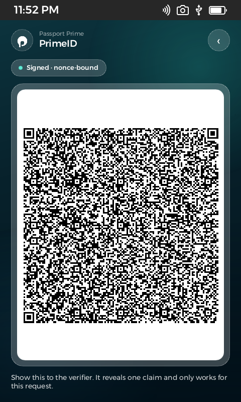 |
| Key from the secure-element app seed; the issuer reads this QR | Issuer signature valid, bound to this Prime | Green **Trusted by you** (key is in your trusted verifiers); only `over_18` is shared | One claim, signed, bound to the nonce |

**Attacks, all stopped:**

| Forged "AI fake ID" | Copied credential | Fake bank (phishing) | Revoked credential |
|---|---|---|---|
| 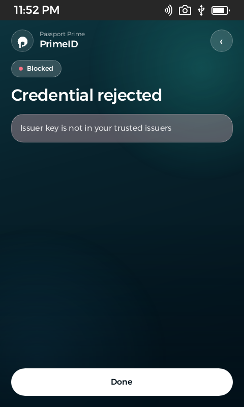 | 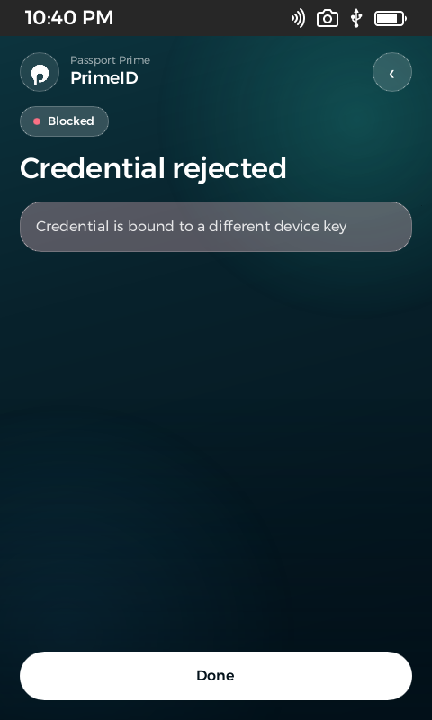 | 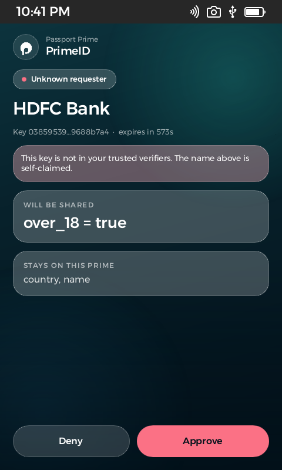 | 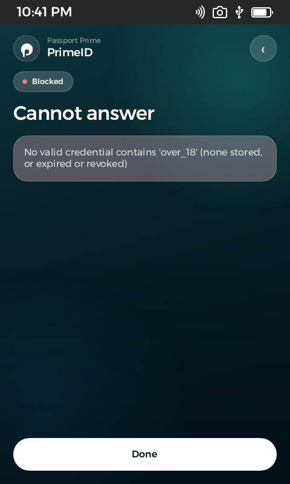 |
| **Untrusted issuer**: validly signed, but by a key the user never trusted (Prime and the verifier both reject it) | Bound to a different device's key | Name is self-claimed, key not in your list: **Not in your trusted list** | Issuer-signed revocation list, so Prime refuses to answer |

The fourth attack, a **replayed answer**, is caught by the verifier: a new request has a new nonce, so the
old answer fails check 4.

| Revocation accepted | Privacy receipts | Credentials |
|---|---|---|
| 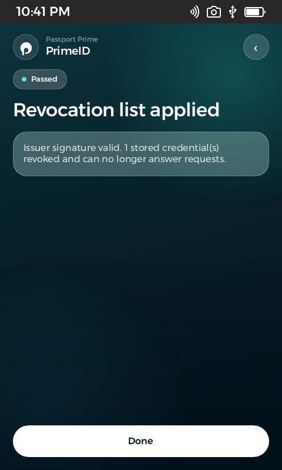 | 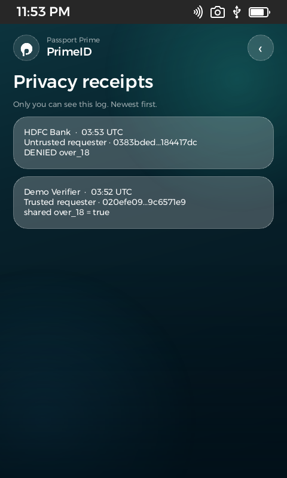 | 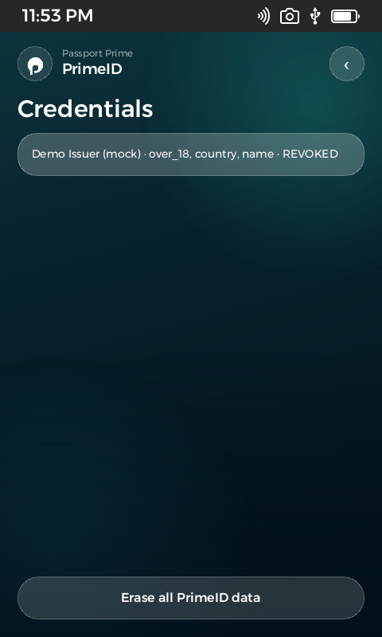 |
| Only a trusted issuer's signed list is accepted | Local log of every approval and denial, visible only to the user | Status per credential: valid / EXPIRED / REVOKED |

## What uses Passport Prime / KeyOS (real SDK calls)

| Capability | KeyOS API used |
|---|---|
| Holder key from the secure element | `security::Security::app_seed()`, a per-app seed (permission `os/security: GetAppSeed`, user-granted). Key = `SHA256("primeid/holder/v1" ‖ seed)`, so it survives a seed restore and never leaves the device |
| Encrypted private storage | `cx.fs.durable_file_write/read(…, Location::AppData)` |
| Camera QR scanning | `slint_keyos_platform::navigation::open_qr_scanner` |
| QR display | `slint_keyos_platform::qrcode::render` |
| UI | Slint on KeyOS (`app_ui2!`), a custom glass theme with the PrimeID logo |

If the secure element refuses the seed, the app shows an error screen. There is **no fallback key**.

## Security checks

On **Prime** (`packages/primeid-core`, Rust):
- issuer signature → issuer in the user's **trusted issuers** → holder key == this Prime → not expired → every disclosed salt matches a signed hash
- the request signature is verified; the requester is shown green (**Trusted by you**) only if its key is in the user's own **trusted verifiers** list
- the verifier accepts an answer only from an issuer **it** trusts, and a yes/no claim only when its value is `true`: a valid proof of `over_18 = false` prints *PROOF VALID, BUT NOT ACCEPTED*
- expiry is re-checked at the moment of approval; nothing is revealed without an on-device tap
- revocation lists are accepted only from trusted issuers, and an older list cannot replace a newer one
- a credential ID from a different issuer cannot overwrite a stored credential

On the **verifier** (`scripts/primeid.mjs verify`): 7 checks covering issuer signature, trusted issuer, claim hash,
holder signature, nonce and verifier key, expiry, and the requested claim. Each nonce works only once.

## Repository map

| Path | What |
|---|---|
| `primeid/` | **The KeyOS app** (Rust + Slint): `src/main.rs`, `ui/app.slint`, `app-config.toml` |
| `packages/primeid-core/` | Device crypto and protocol logic plus unit tests, and `compat.mjs` (cross-check against noble) |
| `scripts/primeid.mjs` | Laptop demo **issuer and verifier** CLI (writes each payload as a QR `.png` and as `.json`) |
| `scripts/sim.sh` | Build and launch the app in the KeyOS simulator (WSL) |
| `scripts/sim-e2e.sh` | Automated end-to-end test that drives the real app in the simulator |
| `scripts/sim-send.sh` | Types a payload into the simulator (stand-in for the camera) |
| `DEMO.md` | Step-by-step live demo runbook |
| `docs/idea.md` | Original product document |
| `archive/` | Earlier prototype (IncogID web suite and mock apps), kept for history only. **Not part of PrimeID** |

## Run it

```bash
# WSL (Ubuntu) with the Foundation SDK + Nix installed
bash scripts/sim.sh                      # build + launch PrimeID in the KeyOS simulator
bash scripts/sim-e2e.sh                  # full automated flow + attacks + revocation
```
Manual demo (Windows terminal, repo root): see **[DEMO.md](DEMO.md)**.
```
node scripts/primeid.mjs trust issuer | trust verifier
node scripts/primeid.mjs key <screenshot-of-key-QR.png>
node scripts/primeid.mjs issue
node scripts/primeid.mjs request
node scripts/primeid.mjs verify <screenshot-of-answer-QR.png>
node scripts/primeid.mjs attack forged|copied|fakebank
node scripts/primeid.mjs revoke
```
Unit tests: `cd packages/primeid-core && cargo test`.

## Trust model (what the green badge means)

The badge means **"trusted by you"**: the requester's key is one *this user* added to Prime earlier. In
this demo, trust cards are added by hand, and they are not signed by anyone. A phishing site could therefore
try to get its own trust card accepted first, which is why adding one needs an explicit on-device
**Trust** tap on a screen that shows the name, role and key. In production, verifiers and issuers would be registered with a trust
authority (for example a government or industry registry) that signs their keys, and Prime would ship
with that authority's root key instead of relying on hand-added cards.


## Test status (honest)

**Implemented and tested in the simulator:** secure-element key, trust cards, credential import, request
review, approval with the answer QR (decoded from a screenshot and verified with all 7 checks), replay rejection, forged,
copied and fake-bank attacks, revocation, receipts, persistence across restart, erasing all data.

**Implemented, not yet tested:**
- On a physical Passport Prime: the ARM build compiles, but a signed `.app` needs a publisher signing identity.
- Scanning through a real camera: the simulator has no webcam inside WSL, so payloads are typed in through
  **Enter payload**, which runs exactly the same checks.

**Simulator note:** the *Enter payload* field moves text into a buffer every 160 characters, because the simulator GUI deadlocked when it had to lay out about 1 KB of text in one field.

**Not built (roadmap):** e-passport NFC import, x401 web requests, unlinkable batch or BBS+ credentials, ZK proofs,
and zkSync anchoring. Today the issuer signature and bound key repeat across verifiers, so the
credential is linkable until batch credentials land.
